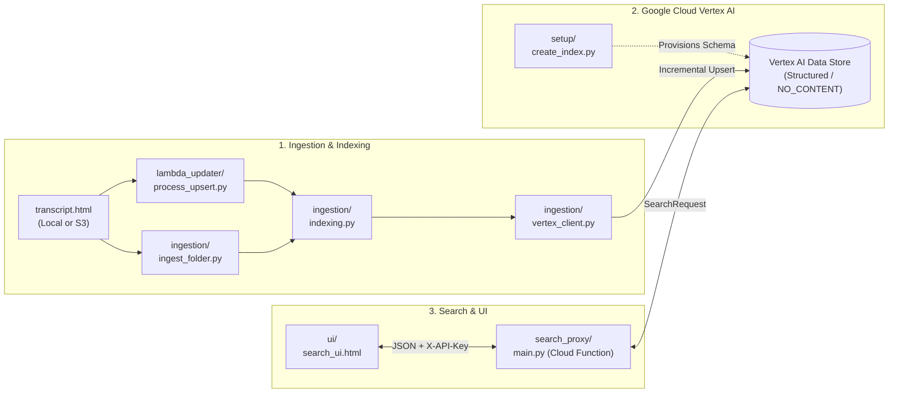

# Structured Transcript Search with Vertex AI (Reference Implementation)

> **Dual-Use Documentation Notice (Humans & LLMs)**
> This repository and README are structured for both **human engineers** and **AI Coding Agents / LLMs**. It includes architectural explanations alongside strict data contracts, JSON schemas, HTML input specifications, and invariant rules required to replicate this search pipeline without regression.

---

## 1. Overview

This repository provides a complete, production-tested pipeline for indexing time-coded HTML transcripts into **Google Cloud Vertex AI Search (`discoveryengine`)** and serving semantic search queries with **native bolded snippets (`<b>...</b>`)**, metadata filtering, chronological sorting, and video timestamp deep-linking.

### Key Capabilities
- **Agenda-Boundary Semantic Chunking**: Parses timestamped HTML transcripts and groups utterances by `<nav id="agenda">` boundaries (with time-window fallbacks) rather than arbitrary character splits.
- **Native Bolded Snippets ("The Quad of Success")**: Programmatically provisions structured Vertex AI data stores so search results return exact highlighted snippets.
- **Event-Driven S3 to Lambda Upserts**: Automatically indexes new or updated `transcript.html` files when uploaded to AWS S3.
- **Relevance-Tuned Search Proxy (GCF)**: A Google Cloud Function proxy that protects backend credentials, translates `YYYY-MM-DD` date filters into POSIX epoch range queries, and dynamically adjusts Vertex AI relevance thresholds based on sort order.
- **Zero-Build Reference UI**: Clean HTML/JS search interface with filters, sorting, and deep-link navigation.

---

## 2. System Architecture & Repository Bill of Materials (BoM)



### Bill of Materials (File Map)

| Path | Component Role | Primary Entrypoint / Function |
| :--- | :--- | :--- |
| `setup/create_index.py` | Creates regional `NO_CONTENT` Vertex AI Data Store & patches JSON schema | `provision_index()`, `create_data_store()`, `configure_schema()` |
| `ingestion/indexing.py` | Parses `transcript.html`, chunks by agenda/time, formats `structData` | `parse_transcript_html()`, `group_utterances_by_agenda()`, `format_indexing_record()` |
| `ingestion/vertex_client.py` | Executes batched incremental `ImportDocumentsRequest` upserts to Vertex AI | `upsert_documents()`, `list_documents()` |
| `ingestion/ingest_meeting.py` | CLI/module to parse and upsert a single local or S3 `transcript.html` | `ingest_meeting()` |
| `ingestion/ingest_folder.py` | Batch CLI to scan local directories or S3 prefixes and upsert transcripts | `run_batch_ingestion()`, `ingest_s3_bucket()`, `ingest_local_folder()` |
| `lambda_updater/process_upsert.py` | AWS Lambda handler triggered by S3 `ObjectCreated` events | `lambda_handler(event, context)` |
| `search_proxy/main.py` | Google Cloud Function HTTP proxy for browser/client search requests | `search_transcripts(request)`, `perform_search()` |
| `ui/search_ui.html` | Reference frontend UI for querying, filtering, and rendering deep-linked snippets | Browser DOM / `performSearch()` |
| `samples/sample_transcript.html` | Sample input transcript demonstrating required HTML DOM markers | N/A (Static fixture) |

---

## 3. Critical Architectural Invariants (Read Before Modifying)

> [!IMPORTANT]
> **LLM & Developer Guardrails**: Do NOT alter the following three rules when adapting this codebase. Violating any of them will break snippet highlighting, cause HTTP 400 schema errors, or starve chronological search results.

### 3.1 The "Quad of Success" for Vertex AI Snippets
For Vertex AI Search (Standard Edition) to return native bolded snippets (`<b>...</b>`) on structured documents, all four conditions in `setup/create_index.py` must hold:
1. **Content Config**: The Data Store MUST be created with `content_config = ContentConfig.NO_CONTENT` (Structured mode).
2. **REST Schema Patch**: The schema MUST be patched via the `v1beta` REST API (`schemas/default_schema`).
3. **Key Property Mapping**: In `structSchema.properties`:
   - `content` MUST map to `"keyPropertyMapping": "description"`
   - `meeting_title` MUST map to `"keyPropertyMapping": "title"`
   - `deep_link` MUST map to `"keyPropertyMapping": "uri"`
4. **No Illegal Annotations on Mapped Fields**: Fields with `keyPropertyMapping` (`content`, `meeting_title`, `deep_link`) MUST **NOT** include `"indexable": true` or `"searchable": true` in the schema patch, or Vertex AI will reject the patch with `HTTP 400`.

### 3.2 Dynamic Relevance Thresholds (`search_proxy/main.py`)
Vertex AI Search evaluates `RelevanceThreshold` *before* applying `order_by`.
- When `sort` is `date_desc` or `date_asc`, the proxy forces `RelevanceThreshold.LOWEST` (`1`) so recent meetings with moderate semantic similarity are not prematurely culled.
- When `sort` is `relevance`, the proxy defaults to `RelevanceThreshold.LOW` (`2`) to filter out weak semantic matches.

### 3.3 Numeric Epoch Date Filtering (`sort_timestamp`)
Vertex AI Search throws an error if range operators (`>=`, `<=`) are applied to string fields like `date`.
- During ingestion, `ingestion/indexing.py` computes a numeric POSIX timestamp float (`sort_timestamp`) from the meeting date/time plus clip offset.
- During search, `search_proxy/main.py` intercepts `date_ge` and `date_le` (`YYYY-MM-DD`), converts them to POSIX floats, and filters against `sort_timestamp >= ... AND sort_timestamp <= ...`.

---

## 4. Data Contracts & Schemas

### 4.1 Input HTML Contract (`transcript.html`)
`ingestion/indexing.py` expects HTML files conforming to the following structure:

```html
<!DOCTYPE html>
<html>
<body>
  <!-- 1. Jurisdiction Header (Optional: used for auto-detecting index target) -->
  <header><a href="/">Example State SmartTranscripts</a></header>

  <!-- 2. Meeting Title (Include YYYY-MM-DD for fallback date extraction) -->
  <h2 id="meeting-title">Senate Agriculture - 2026-03-15</h2>

  <!-- 3. Agenda Navigation (Optional: drives semantic agenda chunking) -->
  <nav id="agenda">
    <ul>
      <li><a href="#item-1">Call to Order and Roll Call (00:00:15)</a></li>
      <li><a href="#item-2">S.102 - Dairy Pricing Reform (00:12:40)</a></li>
    </ul>
  </nav>

  <!-- 4. Transcript Utterances -->
  <div id="transcript">
    <p>
      <strong>[Sen. Jane Doe]:</strong>
      <span class="utterance" data-start-time="15.2">Welcome to the Senate Agriculture Committee.</span>
      <span class="utterance" data-start-time="19.8">Today we are reviewing S.102.</span>
    </p>
  </div>
</body>
</html>
```

### 4.2 Vertex AI Document Schema & Upsert Payload (`JSONL`)
Each chunk generated by `format_indexing_record()` produces a JSON record with the following layout:

```json
{
  "id": "senate_agriculture_2026-03-15_10-00_760",
  "structData": {
    "content": "Agenda Item: S.102 - Dairy Pricing Reform\n\nToday we are reviewing S.102...",
    "meeting_title": "Senate Agriculture - 2026-03-15 - S.102 - Dairy Pricing Reform",
    "date": "2026-03-15",
    "meeting_time": "10:00",
    "sort_timestamp": 1773569560.0,
    "start_time": 760.0,
    "end_time": 985.5,
    "transcript_url": "/meetings/Senate/Agriculture/2026-03-15_10-00/transcript.html",
    "deep_link": "/meetings/Senate/Agriculture/2026-03-15_10-00/transcript.html?startTime=760.0&endTime=985.5",
    "jurisdiction": "example-legislature-v1",
    "chamber": "Senate",
    "committee": "Agriculture",
    "meeting_id": "2026-03-15_10-00",
    "agenda_item": "2",
    "meeting_path": "Senate/Agriculture/2026-03-15_10-00",
    "speakers": ["Sen. Jane Doe", "Witness John Smith"]
  }
}
```

### 4.3 Search Proxy API Contract (`POST /search_transcripts`)

#### Request Headers
- `Content-Type: application/json`
- `X-API-Key: <YOUR_SEARCH_API_KEY>` (or pass `?key=<YOUR_SEARCH_API_KEY>`)

#### Request Body Schema
```json
{
  "query": "dairy pricing reform",
  "index_name": "example-legislature-v1",
  "region": "us",
  "jurisdiction": "example",
  "max_results": 25,
  "sort": "relevance",
  "chamber": "Senate",
  "committee": "Agriculture",
  "date_ge": "2026-01-01",
  "date_le": "2026-04-01"
}
```
- **Mandatory fields**: `query`, `index_name` (RFC 1034 lowercase/hyphens), `region` (`us` or `global`).
- **Sort options**: `"relevance"` (default), `"date_desc"`, `"date_asc"`.

#### Response Body Schema (`200 OK`)
```json
{
  "results": [
    {
      "id": "senate_agriculture_2026-03-15_10-00_760",
      "meeting_title": "Senate Agriculture - 2026-03-15 - S.102 - Dairy Pricing Reform",
      "date": "2026-03-15",
      "chamber": "Senate",
      "committee": "Agriculture",
      "meeting_id": "2026-03-15_10-00",
      "agenda_item": "2",
      "start_time": 760.0,
      "end_time": 985.5,
      "timestamp": 760.0,
      "snippet": "...reviewing S.102 on <b>dairy pricing reform</b> across the state...",
      "deep_link": "/meetings/Senate/Agriculture/2026-03-15_10-00/transcript.html?startTime=760.0&endTime=985.5"
    }
  ]
}
```

---

## 5. Step-by-Step Deployment Guide

### Prerequisites
- Python 3.10+
- Google Cloud SDK (`gcloud`) authenticated with Discovery Engine Admin permissions (`roles/discoveryengine.admin`)
- Install dependencies:
  ```bash
  pip install -r requirements.txt
  ```

### Step 1: Establish the Vertex AI Index
Run `setup/create_index.py` to create the regional structured Data Store and patch its schema:
```bash
python setup/create_index.py \
  --project your-gcp-project-id \
  --region us \
  --jurisdiction example-legislature \
  --version v1
```
*Output*: Creates datastore `example-legislature-v1` in region `us` and configures snippet mappings.

### Step 2: Populate the Index (Single File or Batch Folder/S3)
Test parsing and record generation locally using `--dry-run` with the included sample transcript:
```bash
python ingestion/ingest_meeting.py \
  --jurisdiction example-legislature \
  --target-index us:example-legislature-v1 \
  --file samples/sample_transcript.html \
  --dry-run
```
Remove `--dry-run` (and provide `--project your-gcp-project-id` or set `GCP_PROJECT_ID`) to upsert to Vertex AI, or batch-ingest an entire local folder or S3 bucket:
```bash
# Local directory tree
python ingestion/ingest_folder.py \
  --jurisdiction example-legislature \
  --target-index us:example-legislature-v1 \
  --folder ./samples \
  --start-date None

# S3 Bucket
python ingestion/ingest_folder.py \
  --jurisdiction example-legislature \
  --target-index us:example-legislature-v1 \
  --folder s3://your-transcripts-bucket/meetings \
  --start-date None
```

### Step 3: Deploy the AWS Lambda S3 Updater (Optional Real-Time Sync)
Package `lambda_updater/process_upsert.py` alongside `ingestion/` and configure an S3 `ObjectCreated` event trigger for suffix `transcript.html`.
Set the following Lambda environment variables:
- `GCP_PROJECT_ID`: Your Google Cloud Project ID
- `TARGET_INDEX`: `us:example-legislature-v1`
- `JURISDICTION`: `example-legislature`
- `GOOGLE_APPLICATION_CREDENTIALS`: Path to mounted service account key JSON (or use `GCP_SERVICE_ACCOUNT_JSON` string)

### Step 4: Deploy the Search Cloud Function Proxy
Deploy `search_proxy/main.py` to Google Cloud Functions:
```bash
gcloud functions deploy search-transcripts \
  --runtime python311 \
  --region us-east4 \
  --source search_proxy \
  --entry-point search_transcripts \
  --trigger-http \
  --allow-unauthenticated \
  --set-env-vars PROJECT_ID=your-gcp-project-id,SEARCH_API_KEY=your-secret-api-key
```
*(Or run locally for development via `functions-framework --target=search_transcripts --source=search_proxy/main.py --port=8080`).*

### Step 5: Launch the Sample Search UI
Serve the `ui/` directory locally and open `http://localhost:8000/search_ui.html`:
```bash
python -m http.server 8000 --directory ui
```
Enter your GCF endpoint URL, API key, and target index (`example-legislature-v1|us`) in the UI controls to test queries, filters, and deep-links.

---

## 6. Adaptation Playbook for AI Coding Assistants (LLMs)

If a user asks you (an AI assistant) to adapt this repository to a new document format or domain (e.g., podcasts, legal depositions, city council meetings, or lecture videos):

1. **Preserve `setup/create_index.py` Core Mappings**: Keep `content` (`description`), `meeting_title` (`title`), `deep_link` (`uri`), and `sort_timestamp` (`number`, `indexable: True`). Add any custom domain metadata fields (e.g., `case_number`, `course_id`, `host`) as `indexable: True` properties in `configure_schema()`.
2. **Modify Only the Parser in `ingestion/indexing.py`**:
   - Replace `parse_transcript_html()` with a parser for the user's input format (HTML, WebVTT, SRT, Whisper/Deepgram JSON) that returns `{ "title", "date", "utterances": [{"text", "start", "speaker"}], "agendas": [{"title", "item_number", "start_time"}] }`.
   - Keep `group_utterances_by_agenda()` and `format_indexing_record()` intact so chunking and `sort_timestamp` calculation remain consistent.
3. **Update Filter Bindings in `search_proxy/main.py`**:
   - In `perform_search()`, add any new custom metadata filters using Vertex AI filter syntax: `field_name: ANY("value")` for strings or `field_name >= value` for numbers.
